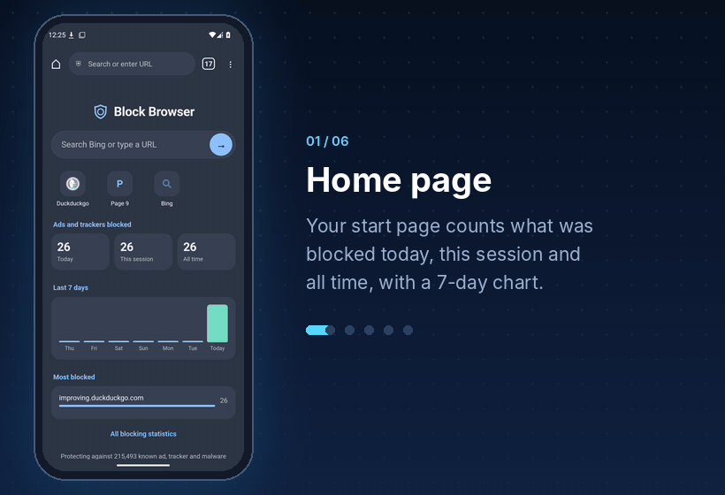
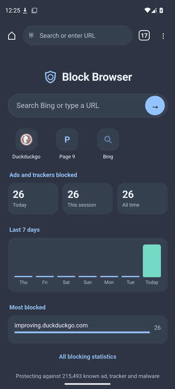
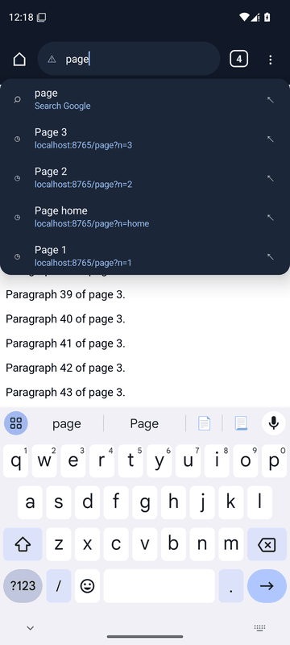
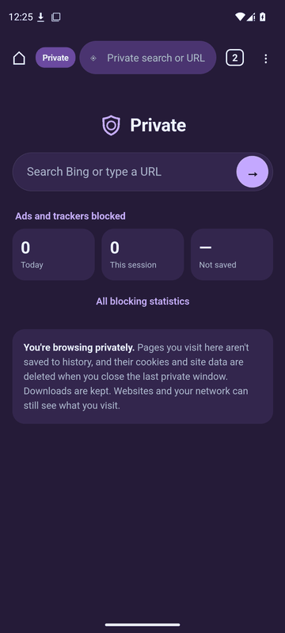
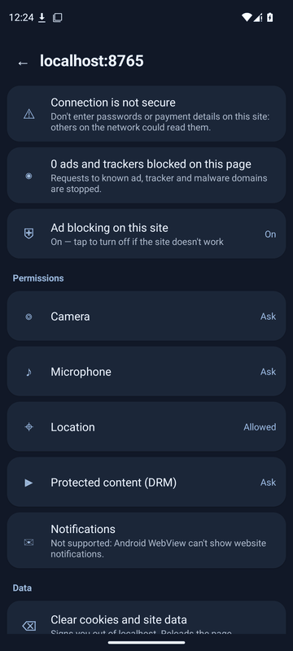
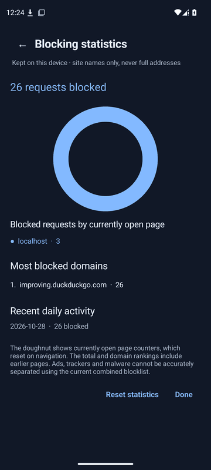
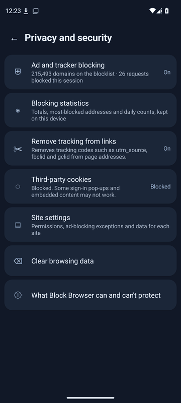
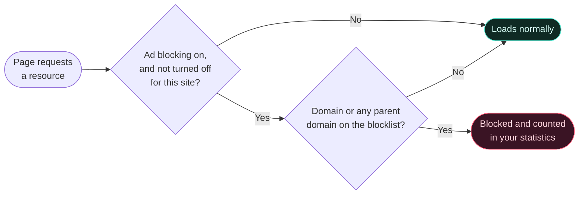

<div align="center">



<br>

[](https://github.com/billyke2000s/Blockbrowser/releases/latest)
[](https://github.com/billyke2000s/Blockbrowser/actions/workflows/android.yml)
[](https://github.com/billyke2000s/Blockbrowser/releases)
[](#-install)
[](#%EF%B8%8F-build-from-source)
[](#%EF%B8%8F-how-blocking-works)

<br>

<a href="https://github.com/billyke2000s/Blockbrowser/releases/latest/download/BlockBrowser-debug.apk">
  
</a>

<br><br>

**A lightweight Android browser with ad and tracker blocking built in.**<br>
Private windows, smart tabs, HLS video downloads and a clean dark interface — no extensions, no accounts, no telemetry.

[Features](#-features) · [Tour](#-take-the-tour) · [Install](#-install) · [Private browsing](#%EF%B8%8F-private-browsing) · [How blocking works](#%EF%B8%8F-how-blocking-works) · [Limitations](#%EF%B8%8F-known-limitations) · [Build](#%EF%B8%8F-build-from-source)

</div>

<br>

## ✨ Features

<table>
<tr>
<td width="50%" valign="top">🛡️ <b>Ad & tracker blocking</b><br><sub>215,000+ domains blocked, on or off per site</sub></td>
<td width="50%" valign="top">🕶️ <b>Private windows</b><br><sub>Isolated, and wiped when you close them</sub></td>
</tr>
<tr>
<td valign="top">🏠 <b>Home page</b><br><sub>Search, top sites and your blocking stats</sub></td>
<td valign="top">🔎 <b>Smart address bar</b><br><sub>Suggestions from bookmarks and history</sub></td>
</tr>
<tr>
<td valign="top">🗂️ <b>Tabs</b><br><sub>Previews, swipe to close, drag to reorder</sub></td>
<td valign="top">🎬 <b>Video downloads</b><br><sub>Files and HLS streams, saved as MP4</sub></td>
</tr>
<tr>
<td valign="top">🔒 <b>Privacy controls</b><br><sub>No third-party cookies or tracking links</sub></td>
<td valign="top">📍 <b>Site permissions</b><br><sub>Asked per site and remembered</sub></td>
</tr>
<tr>
<td valign="top">⭐ <b>Bookmarks & history</b><br><sub>Folders, search, import and export</sub></td>
<td valign="top">⛶ <b>Full screen</b><br><sub>Hides all bars; video goes picture-in-picture</sub></td>
</tr>
</table>

<details>
<summary><b>Full feature details</b></summary>
<br>

- **Ad and tracker blocking** — requests to about 215,000 known advertising, tracking and malicious domains (and their subdomains) are stopped before they leave your phone. Turn it off for a single site from the site information button if the site breaks.
- **Private windows** — a separate process with its own cookies and storage, deleted when the window closes, even after a crash or force-stop. [More ↓](#%EF%B8%8F-private-browsing)
- **Home page** — Block Browser's own start and new-tab page: a search box (your chosen engine, Google by default), shortcuts to your most visited sites, and how many ads and trackers were blocked today, this session and in total, with a 7-day chart and the most-blocked domains. Built into the app, never loaded from the internet. **Settings → Homepage** can switch to any other address.
- **Smart address bar** — suggestions from your bookmarks and history with titles and site icons, ranked by how well the address matches and how often and recently you visited. Optional suggestions from your search engine (off by default). Ten search engines to choose from.
- **Tabs** — a grid of open tabs with page previews: swipe or tap × to close, Undo, drag to reorder, duplicate, close others or all. Links from other apps open in a new tab. Tabs are restored after a restart and only load when you open them.
- **Video downloads** — plain video files and HLS streams (`.m3u8`), the format most news, sports and social sites use. Pick a quality and it downloads in the background, saved as one MP4. Built-in player with aspect-ratio controls (fit, fill, zoom, 16:9, 4:3). [Details ↓](#-video-downloads)
- **Privacy controls** — third-party cookies blocked by default, tracking parameters (`utm_*`, `fbclid`, `gclid`…) removed from links, choose exactly what to clear, and clear cookies and data for one site. Certificate errors are never bypassed.
- **Site permissions** — camera, microphone, location and protected media are asked per site and remembered. Review or change them in the site information panel or **Settings → Privacy and security → Site settings**.
- **Bookmarks and history** — bookmark folders, edit, move, delete, search, and import or export as HTML (works with Chrome, Firefox, Edge and Safari) or JSON. History grouped by day or by website, searchable; delete a page, a day, a website or a time range.
- **Full screen** — hides the browser and system bars and stays on as you browse. Full-screen video continues in picture-in-picture when you leave the app.
- **More** — find in page, share, desktop site, darken websites, translate, reader mode, print or save as PDF, add to home screen, and a downloads manager with live progress.

</details>

## 📱 Take the tour

<div align="center">
  
  <br>
  <sub>Real screenshots from Android 15, captured automatically by the project's emulator tests.</sub>
</div>

<details>
<summary><b>View the screenshots side by side</b></summary>
<br>

| Home page | Address bar | Private window |
|:---:|:---:|:---:|
|  |  |  |
| **Site information** | **Blocking statistics** | **Privacy and security** |
|  |  |  |

</details>

## 📥 Install

1. Open the [latest release](https://github.com/billyke2000s/Blockbrowser/releases/latest) (or tap the **Download APK** button above).
2. Download `BlockBrowser-debug.apk` on your Android phone.
3. Open it and follow the installation prompts. You may need to allow installs from your browser or file manager.

> [!IMPORTANT]
> **Android 8.0 or newer is required.** Private windows need Android 9 or newer.

> [!WARNING]
> **Updating from an old build?** Builds published before the stable signing key was set up were each signed with a different throwaway key, so Android refuses to install a new one over them (*"App not installed"* or *"package conflicts"*). Uninstall the old version once.
>
> To keep your bookmarks, export them first — old versions: **⋮ → Export browser data → Bookmarks**, save the text as a `.json` file; new versions: **Bookmarks → Import / Export** — then import the file afterwards in **Bookmarks → Import / Export**. Builds signed with the stable key update in place.

## 🧭 Using Block Browser

| To… | Do this |
|---|---|
| Open the menu | Tap **⋮**. Back, forward, reload, bookmark (☆) and site information are along its top. |
| Switch tabs | Tap the square with the tab count. |
| See site information | Tap 🔒 or ⚠ at the left of the address bar: connection, blocked trackers, permissions and site data. |
| Change settings | **⋮ → Settings** for search engine, search suggestions, homepage, text size and darkening.<br>**⋮ → Privacy and security** for ad blocking, tracking-parameter removal, third-party cookies and site settings. |
| Download a video | Start the video playing, then **⋮ → Download video**. If the page has several, pick one; for streams with several qualities, pick the quality. Streams download in the background with a progress notification and are saved to Downloads as an MP4. |
| Change a video's shape | In full-screen website video or the built-in player, tap the aspect-ratio button and pick **Fit**, **Fill**, **Zoom**, **16:9** or **4:3**. |
| Go full screen | **⋮ → Full screen**. The floating control fades after three seconds; tap its position to show it, then tap to exit. Back also exits. |

## 🕶️ Private browsing

**⋮ → New private window** (Android 9 or newer) opens a window marked **Private**. It runs in a separate app process with its own cookies, site storage, cache and service workers, so sites can't see your normal logins and normal windows can't see private ones.

<details>
<summary><b>Exactly what private windows do</b></summary>
<br>

- Nothing from a private window is saved to history, the session, recently closed tabs or site icons, and search-engine suggestions are never fetched there.
- Permission decisions last only until the window closes. Normal "Block" decisions carry over; normal "Allow" decisions don't.
- It starts with your normal settings. Settings changed inside it apply only until it closes.
- Your bookmarks and history are available for suggestions, but can't be changed from a private window.
- Android Autofill is off, and the keyboard is asked not to learn what you type (your keyboard app decides whether to honour that).
- Private pages are hidden from the recent-apps preview. On Android 12 and older this also blocks screenshots in private windows.
- When the last private window closes, its cookies and site data are deleted and its process ends. If the app crashes or is force-stopped, leftovers are deleted before they can be used again.

Isolation is tested automatically on Android 9, 14 and 15 emulators — see [TESTING.md](TESTING.md#private-browsing-isolation).

</details>

> [!NOTE]
> Downloads from a private window are saved to your Downloads folder and appear in Android's download list and notifications like any other download. Private browsing hides your activity from this app and other people using the phone — **not** from websites, your network or your internet provider.

## 🛡️ How blocking works

Every request a page makes is checked against the bundled blocklist before it's allowed through:



A blocked page shows a short explanation; a blocked image, script or frame fails outright, the way a DNS blocker would, rather than getting an empty reply.

The blocklist combines [StevenBlack's hosts](https://github.com/StevenBlack/hosts) and [HaGeZi Multi PRO](https://github.com/hagezi/dns-blocklists), and is refreshed on every build.

> [!TIP]
> Domain filtering is not the same as full content filtering: first-party advertisements, some embedded ads and certain video ads may still appear. If a website fails to load correctly, turn ad blocking off for that site from the site information button.

## 🎬 Video downloads

Block Browser catches a video stream as the page plays it, downloads every piece and saves one MP4, combining separate video and audio tracks.

| ✅ Works with | ❌ Can't download |
|---|---|
| Plain video files (`<video>` sources) | **Copy-protected video** — Netflix, Disney+, Prime Video and other DRM, or encrypted HLS |
| **HLS streams** (`.m3u8`), used by most news, sports and social sites | **Live streams** |
| Several qualities — you pick | **DASH streams** (`.mpd`) |
| Downloads from signed-in sites (the site's cookies are sent) | **Unsupported streaming formats** may not download |

Downloading may be against a site's terms; only save videos you have the right to.

## ⚠️ Known limitations

Block Browser is built on Android System WebView, which sets some hard limits.

<details>
<summary><b>Show all limitations</b></summary>
<br>

- **Google sign-in** may refuse to work: Google blocks signing in to Google accounts inside apps' web views.
- **Website notifications** aren't supported by WebView.
- **Downloads can't be paused and resumed**; Android's download manager has no public pause. Files a page creates in memory (`blob:` links) can't be downloaded.
- **Clearing one site's data** removes its storage and the cookies WebView can see; cookies set for specific sub-paths may remain.
- **Search suggestions** use the search engines' informal endpoints, which can change. CI checks them on every build. At the time of writing, Brave Search's endpoint returned a bot-check page to CI (untested from phones), and Startpage and Mojeek have none.
- **Private windows** need Android 9 or newer. Private downloads are saved to your Downloads folder like any other.
- **Darken websites** affects pages without their own dark design; sites with a dark mode follow the app's dark theme anyway on Android 13+.
- **Tab groups** and browser extensions aren't supported.

</details>

## 🛠️ Build from source

Built with Java on Android System WebView, using Gradle.

**Requirements:** JDK 17 · Android SDK platform 35 · Android build tools 35.0.0 · Gradle 8.9

```bash
gradle :app:assembleDebug        # build the app
gradle :app:testDebugUnitTest    # run the unit tests
```

The APK is written to `app/build/outputs/apk/debug/app-debug.apk`.

GitHub Actions builds an APK for every pull request and publishes a release for every push to `main`. Emulator tests (UI layout, browser behaviour, stream downloads and private-window isolation on Android 9, 10, 14 and 15) are described in [TESTING.md](TESTING.md).

<details>
<summary><b>Signing releases</b></summary>
<br>

Published APKs are signed in GitHub Actions with the project's key, taken from four repository secrets (**Settings → Secrets and variables → Actions**):

| Secret | Contents |
|---|---|
| `SIGNING_KEYSTORE_BASE64` | The keystore file, base64-encoded |
| `SIGNING_STORE_PASSWORD` | Keystore password |
| `SIGNING_KEY_ALIAS` | Key alias |
| `SIGNING_KEY_PASSWORD` | Key password |

The build log shows the certificate fingerprint. Without the secrets, builds fall back to a throwaway key and the workflow warns that they can't update an installed copy.

> [!CAUTION]
> Keep a private backup of the keystore. If it's lost, every user has to uninstall to move to a new key.

</details>

## 📜 Open-source components

Block Browser incorporates third-party domain lists, including [StevenBlack hosts](https://github.com/StevenBlack/hosts) (MIT) and [HaGeZi Multi PRO](https://github.com/hagezi/dns-blocklists) (GPL-3.0). Check the applicable upstream licences and distribution obligations when redistributing builds.

See the [changelog](CHANGELOG.md) for what's new.

<br>

<div align="center">
<sub><b>Block Browser</b> — a simpler way to browse Android.</sub>
</div>
